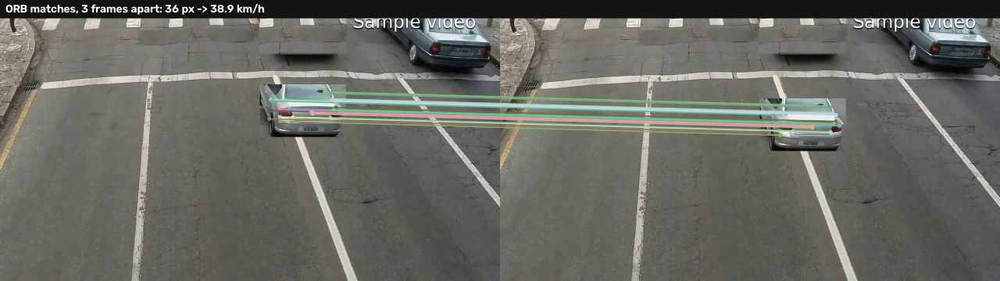
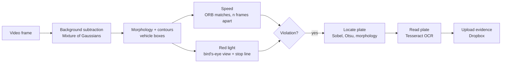
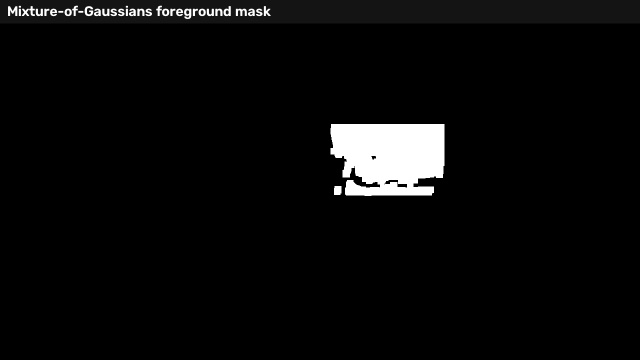
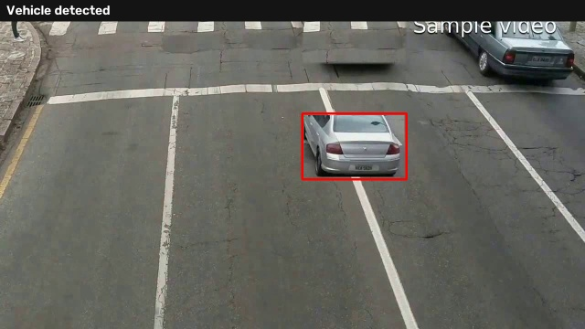
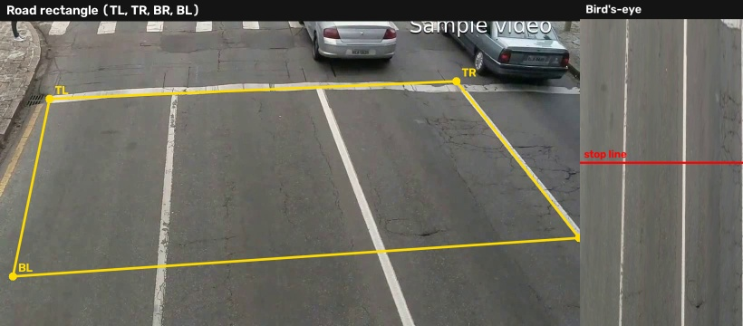
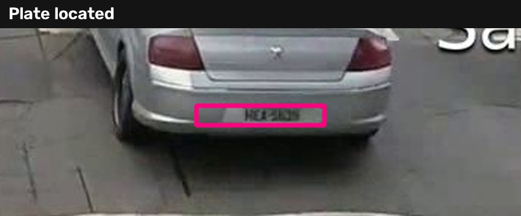
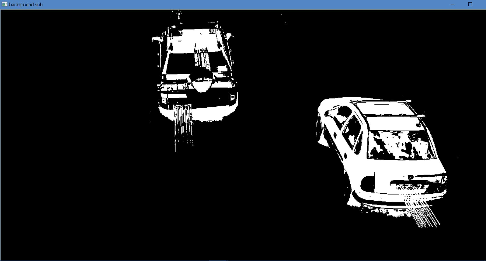
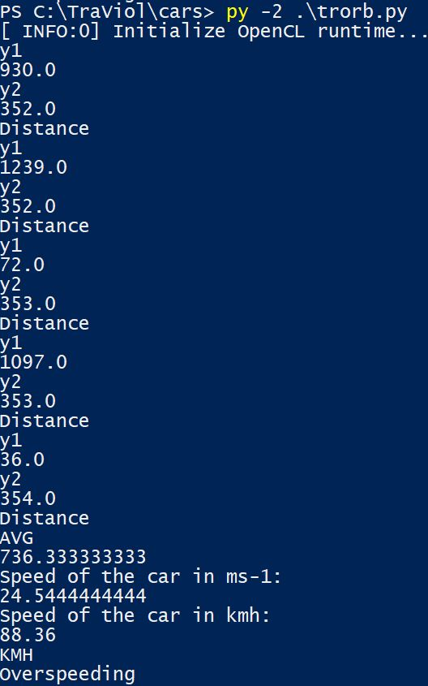
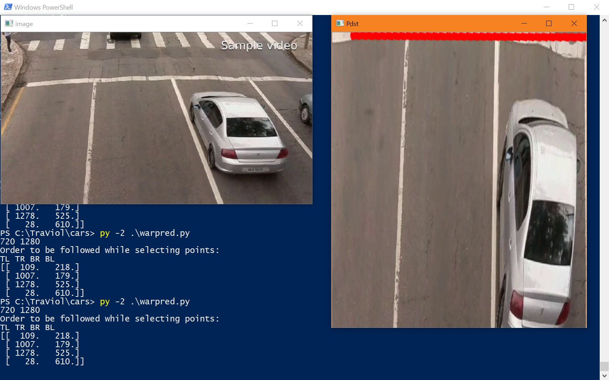

# TraViol: automatic traffic-violation detection from one roadside camera

TraViol watches a fixed traffic camera, finds each moving vehicle, measures its speed, checks whether it crosses the
stop line on red, and for every violation saves the evidence, locates the licence plate, reads it, and sends it to the
cloud for the traffic police. It uses classical computer vision only, so it runs on modest hardware with no training data.

**[▶ Interactive walkthrough](https://cyberdrk.github.io/projects/traviol/)**: drag the road corners to build the
bird's-eye view, move the stop line, and run the speed check yourself.



## At a glance

- **Context:** *Electronics in Service to Society* project, VJTI Mumbai (2018), built by **Dipti Kulkarni,
  Aditi Sharma and Ruhi Dongre**. The motivation, from our presentation: India sees at least 22 traffic violations a
  minute and one road death every four minutes, and enforcement still depends on officers being present.
- **What it detects:** overspeeding and red-light jumping, with zebra-crossing obstruction as the next target.
- **How:** Mixture-of-Gaussians background subtraction finds vehicles, ORB feature matching measures how far they
  move between frames, a perspective transform gives a true top-down view of the road, and Sobel edges plus
  morphology locate the plate for Tesseract OCR. Evidence is pushed to Dropbox.
- **2018 result:** on a test clip the system measured a car at **88.4 km/h** and flagged it for overspeeding.
- **2026 refresh:** ported to Python 3 and current OpenCV as an installable pipeline (`python -m traviol`), with
  speed measured in the bird's-eye view, a synthetic clip with known speed, and tests. The pipeline recovers the
  clip's true speed **to within 0.1 km/h**.

## How it works



### 1. Find moving vehicles
A Mixture-of-Gaussians model learns what the empty road looks like at every pixel, so anything moving stands out in
the foreground mask. Erosion removes speckle, dilation fills each car into one blob, and every blob above a minimum
area becomes a vehicle box (`traviol/detect.py`).

| Foreground mask | Vehicle box |
| --- | --- |
|  |  |

### 2. Measure speed
ORB (Oriented FAST and Rotated BRIEF), a fast, licence-free feature detector, finds distinctive corners on the car in
two frames *n* apart and matches them. A car moves rigidly, so the matched points shift by the same amount; the median
shift, converted to metres, gives the speed (`traviol/speed.py`):

```
t = n_frames / fps        speed = shift_px × metres_per_px / t
```

### 3. Check the red light
The camera sees the road at an angle, so a metre near the camera covers more pixels than a metre far away. Picking the
four corners of a stretch of road that is rectangular in reality gives a perspective transform to a **bird's-eye view**,
where distances are uniform and the stop line is a horizontal row. A vehicle whose front crosses that row while the
signal is red is flagged (`traviol/geometry.py`). With the road length known, speed is also measured in this view.



### 4. Locate and read the plate
Plates are high-contrast and horizontally textured: Sobel edges, Otsu's threshold and a wide closing kernel merge
each plate into one blob, which is kept if its rotated box has a plate-like aspect ratio, area, tilt and edge density
(`traviol/plates.py`). The crop is upscaled and binarised for Tesseract (`traviol/ocr.py`).



### 5. Notify
The frame and plate crop are uploaded to Dropbox for the enforcement agency (`traviol/notify.py`). The access token
comes from the `DROPBOX_ACCESS_TOKEN` environment variable and is never stored in code.

## Results

| Check | Setup | Result |
| --- | --- | --- |
| Speed, 2018 | Test clip, ORB on two stored frames | **88.4 km/h**, flagged as overspeeding |
| Speed, ground truth | Synthetic clip, car moving 18 px/frame at 30 fps, 0.03 m/px (true 58.3 km/h) | **58.3 km/h** |
| Speed, ground truth | Same at 12 px/frame (true 38.9 km/h) | **38.9 km/h**; no violation at a 50 km/h limit |
| Red light | Car crosses the stop line, signal red / green | flagged / not flagged |
| Plate location | Real 1280×720 frame from the test clip | plate found, the only candidate |
| Plate reading | Same frame | not readable: the plate is only 13 px tall; OCR needs closer or higher-resolution footage |

The synthetic clip (`examples/make_synthetic_clip.py`) pastes the real car back onto the empty road at a known speed,
so it checks the whole measurement chain end to end. It moves the car in a straight line in image space, so it does
not test perspective; for real footage, calibrate in the bird's-eye view.

## Run it

```bash
pip install -r requirements.txt         # OCR also needs the tesseract binary

# Build a test clip and run the pipeline on it
python examples/make_synthetic_clip.py --px-per-frame 18 --out samples/synthetic.mp4
python -m traviol samples/synthetic.mp4 --metres-per-pixel 0.03 --speed-limit 50
# {"vehicle": 0, "frame": 33, "violations": ["overspeeding"], "speed_kmh": 58.3, ...}

# Real footage: calibrate with a road rectangle of known length, add a stop line and red phases
python -m traviol junction.mp4 \
    --corners 109,218,1007,179,1278,525,28,610 --road-length 12 \
    --stop-line 0.5 --red 0 25 --red 60 85 \
    --speed-limit 50 --ocr --upload

python -m pytest tests                  # 5 end-to-end checks
python examples/make_figures.py         # rebuild docs/figures
```

Each violation writes the annotated frame, the plate crop and a line in `violations/violations.json`.

## Repository layout

```
traviol/
  detect.py          moving-vehicle detection (MOG2 + morphology + contours)
  speed.py           ORB-based speed estimate
  geometry.py        bird's-eye perspective transform
  plates.py          plate localisation
  ocr.py             plate reading with Tesseract
  notify.py          Dropbox upload (token from the environment)
  __main__.py        the end-to-end pipeline: python -m traviol
original_2018/       the original Python 2 scripts (km.py, trorb.py, pyANPD.py, tesse.py, dropboxupload.py)
examples/            synthetic test clip and figure generation
samples/             a frame from the 2018 test clip
docs/                figures, and screenshots from the 2018 presentation
tests/               end-to-end tests
```

## From the 2018 presentation

| Background subtraction | Speed output | Bird's-eye warp |
| --- | --- | --- |
|  |  |  |

## Limitations and next steps

- **Signal state is an input.** The red phases are given as times; detecting the signal colour from the camera is the
  natural next step.
- **Tracking is simple.** Nearest-centroid tracking works for one lane of traffic; dense traffic needs a proper
  multi-object tracker.
- **Plates need pixels.** Location works at 720p from a high camera; reading needs the plate to be roughly 30 px tall.
- **Zebra-crossing obstruction**, the third violation in our presentation, is not implemented yet. It fits the same
  bird's-eye view: a vehicle stopped inside the crossing area while the pedestrian signal is green.

## Credits

Built by Dipti Kulkarni, Aditi Sharma and Ruhi Dongre at Veermata Jijabai Technological Institute (VJTI), Mumbai.
OCR preprocessing follows Adrian Rosebrock's advice on Tesseract (see `original_2018/tesse.py`). Released under the
MIT License.
